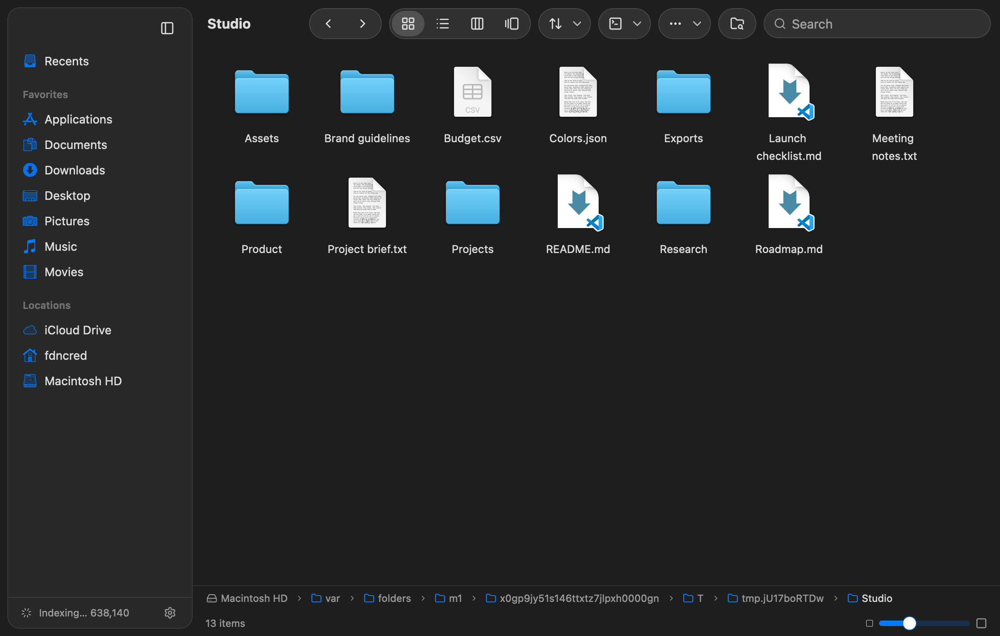
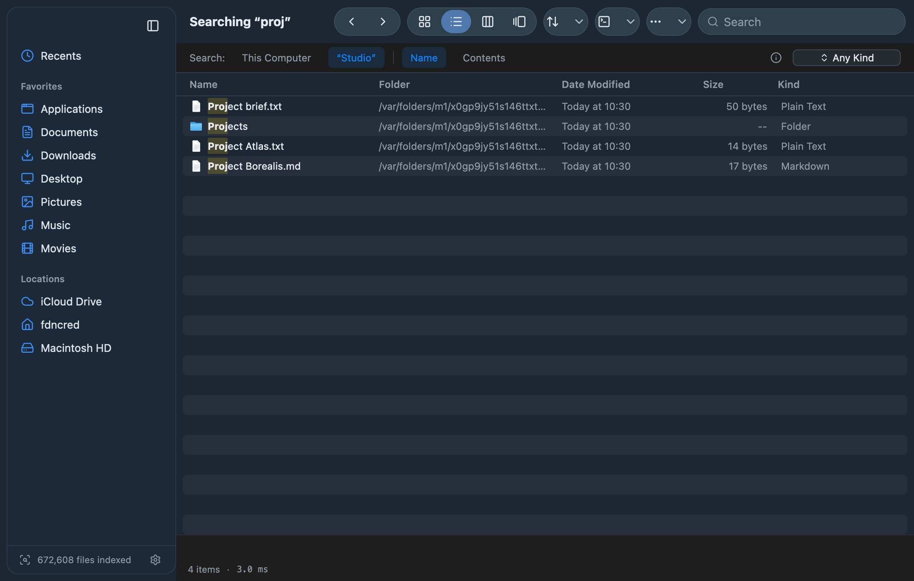
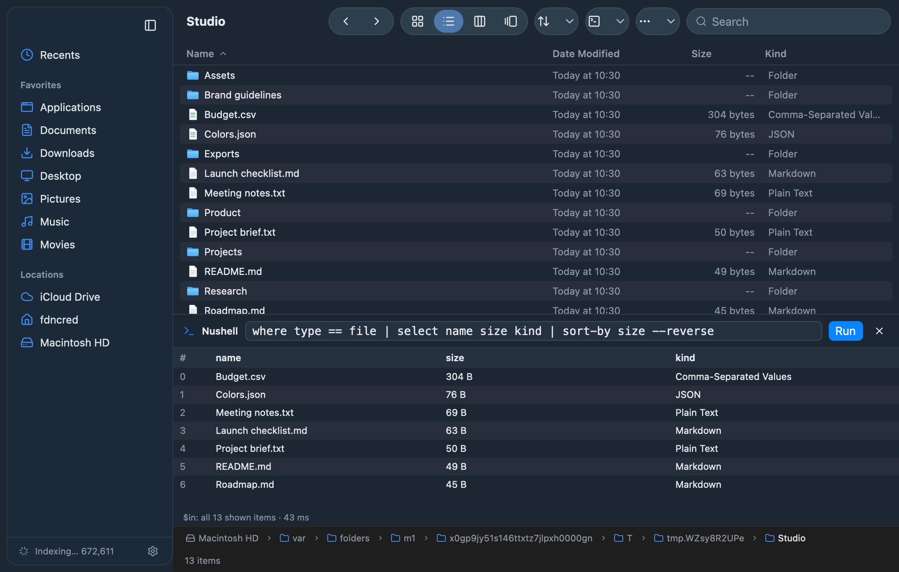

# fffFinder

A Finder-style file browser with instant fuzzy search across your whole
computer, written in Rust. Search uses [fff-search](https://crates.io/crates/fff-search),
the UI is built with [GPUI Kit](https://github.com/longbridge/gpui-kit), and
Nushell is built into both sides: a plugin brings the same search engine to
your shell, and the app runs Nushell pipelines on the files you select.

The look and behavior follow [FinderSearch](https://github.com/zeusinsight/FinderSearch),
a native macOS app. fffFinder targets macOS, Linux, and Windows from one codebase.



## What it does

- Indexes your home folder (and `/Applications` on macOS) in the background and
  keeps the index live with filesystem watchers. On the development Mac that is
  about 670,000 files indexed in 4 to 6 seconds, and a search over all of them
  returns in 30 to 110 ms.
- Searches by name with typo tolerance, or by file contents. You can narrow a
  search to the current folder, a kind (folder, document, image, movie, audio,
  code, archive), an extension, a glob, or a git status.
- Browses folders in four views (icons, list, columns, gallery), with a sidebar,
  back and forward history, a clickable path bar, and a status bar. Gallery
  shows a large preview of the selected item above a strip of everything in
  the folder; arrow keys move along the strip.
- Previews files in the gallery, the column view, and Quick Look (Space).
  Images render as images. CSV, JSON, TOML, YAML, SQLite and other structured
  files open through Nushell's `open` and show as tables.
- Handles everyday file work: open, show in Finder/Explorer, copy paths, copy as
  a Nushell list, rename, new folder, move to Trash, and dragging files out to
  other apps (macOS and Wayland; GPUI doesn't support drag-out on Windows or X11).



## Nushell integration

There are four pieces, and they share one settings file.

**The `fff` plugin** (`nu_plugin_fff`) runs the same engine inside Nushell and
returns tables. The plugin keeps its indexes in memory between calls, so only
the first search in a folder waits for a scan.

```nu
fff main rs                            # fuzzy-find under the current directory
fff --all budget --kind document       # search every configured root
fff *.toml !target | get path          # extension filter, excluding target folders
fff grep TODO *.rs | group-by path     # content search
fff status                             # indexes and settings
fff pick *.csv | open $in              # choose a file in the GUI, use it in the pipeline
fff gui ~/src --query readme           # open the window
```

Search results have `name`, `path`, `type`, `kind`, `size` (a filesize),
`modified` (a date), and `git` when the file has a git status.

**The `fff.nu` module** adds helpers on top of `fff pick`. `fff insert` puts
picked paths on the command line as NUON, `fff cd` jumps to a picked folder,
`fff edit` opens a file in `$env.EDITOR`, and `fff keybindings` binds Ctrl+T and
Alt+C to the first two.

```nu
use ~/src/fffFinder/nu/fff.nu *
fff keybindings
```

**Inside the app**, the Nushell panel (Ctrl+`) runs a pipeline with the selected
files, or everything shown, as `$in`. Each row has the same columns the plugin
returns, so `where size > 1mb | sort-by modified` works as you'd expect, and the
result shows as a table. "Open Nushell Here" opens `nu` in the folder, in the
terminal you choose in Settings (see [Terminal](#terminal)), and "Copy as
Nushell List" copies the selection as NUON.



**`fffFinder --pick`** turns the window into a file chooser for any script.
Return or double-click prints a JSON array of absolute paths and exits 0, and
Escape exits 1. `fff pick` is a thin wrapper around it.

The build, install, packaging, and screenshot scripts in `scripts/` are Nushell
too.

## Install

You need Rust 1.92 or newer and Nushell 0.116.

- macOS: Xcode Command Line Tools (`xcode-select --install`).
- Linux: `gcc g++ clang libfontconfig-dev libwayland-dev libxkbcommon-x11-dev libx11-xcb-dev libssl-dev libzstd-dev`, plus a Vulkan driver.
  The index watches folders with inotify, one watch per folder, and a big home
  folder can exceed the default limit. Raise it with
  `sudo sysctl fs.inotify.max_user_watches=1048576`.
- Windows: Visual Studio 2022 Build Tools with the C++ workload.

```nu
nu scripts/install.nu            # release build into ~/.cargo/bin, then `plugin add`
plugin use fff
```

`nu scripts/install.nu --dest ~/bin` installs somewhere else, and
`--no-register` skips the plugin registration.

To package the app instead:

```nu
nu scripts/bundle.nu             # macOS: dist/fffFinder.app, Linux: a folder with a .desktop file
nu scripts/bundle.nu --install   # Linux: also install the desktop entry for your user
```

macOS asks before an app reads Desktop, Documents, or Downloads. To index those
and other protected folders without prompts, give fffFinder Full Disk Access in
System Settings > Privacy & Security, then reopen it.

## Using it

### Search syntax

| Type | Meaning |
|---|---|
| `budget report` | Fuzzy words, typo tolerant. Every word must match. |
| `*.pdf *.md` | Extensions. Several are ORed. |
| `src/**/*.rs` | A glob against the path inside the search location. |
| `/notes/ todo` | Only paths inside a folder named `notes`. |
| `git:modified` | Git status: `modified`, `untracked`, `staged`, `clean`. |
| `!*.log !test` | Exclude an extension, glob, folder, or text. |

Searches start 50 ms after you stop typing. Return searches right away, and Down
Arrow moves from the search field into the results. When a word matches files
exactly, typo-only matches are dropped, and file-name matches rank above
matches that only appear in a folder name.

### Keyboard

| Keys (Cmd on macOS, Ctrl elsewhere) | Action |
|---|---|
| Cmd+F | Search |
| Cmd+1 to Cmd+4 | Icons, list, columns, gallery |
| Return, Cmd+Down, Cmd+O | Open |
| Space, Cmd+Y | Quick Look |
| Cmd+[ and Cmd+] | Back and forward |
| Cmd+Up | Enclosing folder |
| Cmd+Shift+H, Cmd+Shift+F | Home, Recents |
| Cmd+Shift+G | Go to folder |
| Cmd+Alt+C | Copy path |
| Cmd+Shift+C | Copy as Nushell list |
| Ctrl+` | Nushell panel |
| Cmd+Alt+T | Open Nushell here |
| Cmd+Shift+N | New folder |
| F2 | Rename |
| Cmd+Backspace | Move to Trash |
| Cmd+Shift+. | Show hidden files |
| Cmd+Alt+S | Toggle the sidebar |
| Cmd+, | Settings |

### Settings

Settings live in `settings.json` in the platform config folder
(`~/Library/Application Support/fffFinder` on macOS, `~/.config/fffFinder` on
Linux, `%APPDATA%\fffFinder` on Windows). Set `FFFFINDER_CONFIG_DIR` to use a
different folder. The Settings window edits search locations (including "Index
Entire Disk"), appearance, hidden files, and the terminal.

### Terminal

Settings lists the terminals installed on the computer, and "Open Nushell Here"
uses the one you pick. "Try It" opens it in the current folder. "Automatic"
uses the first of these that is installed:

- macOS: Ghostty, iTerm2, WezTerm, kitty, Alacritty, Rio, then Terminal.
- Windows: Windows Terminal, WezTerm, Alacritty, then a plain console window.
- Linux: `$TERMINAL` if it is set, then Ghostty, WezTerm, kitty, Alacritty, Rio,
  foot, GNOME Terminal, Konsole, Xfce Terminal, then any other terminal.

The choice is saved per operating system, so one settings file can say Ghostty
on macOS and Windows Terminal on Windows:

```json
"terminals": {
  "macos": { "app": "ghostty" },
  "windows": { "app": "windows-terminal" },
  "linux": { "app": "custom", "command": "foot --working-directory={dir} {nu}" }
}
```

"Custom Command" runs any command. `{dir}` becomes the folder and `{nu}` the
path to `nu`, and quotes group words that contain spaces.

Terminals are found the way each system records them. On macOS fffFinder reads
the `Info.plist` of every app in the Applications folders and of every app the
search index finds elsewhere, and an app that adds a "New … Window Here"
service and opens shell scripts counts even if fffFinder doesn't know it. On
Linux it reads `.desktop` entries in the `TerminalEmulator` category, programs
on `PATH`, and AppImages in the index. Flatpak terminals are skipped because
the sandbox can't see the host's `nu`. On Windows it checks the install
folders, `PATH`, and the index, which finds portable and Scoop installs.

Ghostty on macOS opens a new window in the running app through AppleScript, and
macOS asks once whether fffFinder may control Ghostty. If Ghostty isn't
running, or you decline, a new Ghostty instance opens instead. fffFinder avoids
Ghostty's `-e` flag because Ghostty asks for confirmation every time it is used.

## How it's built

```text
crates/fff-finder-core   search engine wrapper, file model, listing, places, settings
crates/nu_plugin_fff     the Nushell plugin
src/                     the GPUI Kit app (src/finder/ holds the window and its views)
nu/fff.nu                Nushell helpers built on `fff pick`
scripts/*.nu             build, install, bundle, screenshots
examples/screenshot.rs   renders the real window headlessly to a PNG
```

The engine keeps one fff index per search root and searches them in parallel.
Folders outside every root get a temporary index the first time you search
them. fff ranks results, then fffFinder re-ranks them the way Finder users
expect: name matches first, shallower paths ahead of deep ones, and nothing from
inside `.app` or `.framework` bundles.

## Development

```nu
nu scripts/build.nu --test --lint    # build, test, clippy
nu scripts/screenshots.nu            # regenerate docs/images (macOS)
cargo run -- ~/src --query readme    # run from source
```

The UI tests open the real window headlessly and use it with mouse clicks and
key presses:

- `tests/controls.rs` clicks every control and checks what each click changed:
  toolbar buttons and menus, the search field and scope bar, sidebar rows, the
  path bar, the icon-size slider, list headers, items in all four views,
  context menus, every button and field in every dialog, the Nushell panel,
  and the picker bar.
- `tests/finder.rs` presses every keyboard shortcut except Quit and New Window,
  which belong to the app rather than the window.

A step that runs longer than 20 seconds fails the run and names the step, so a
hang shows up as a failure instead of a `cargo test` that never ends. Opening a
file or showing it in Finder is recorded instead of performed, and nothing is
moved to the Trash.

`examples/drive.rs` replays the same kind of steps in the visible window
against your real index and prints the window's state after each one. It
never writes your settings.

```nu
cargo run --example drive -- key:cmd-, click:show-hidden key:escape key:cmd-shift-g 'type:~/src' key:enter
```

`examples/screenshot.rs` renders the window to a PNG with Metal, so a UI change
can be checked without opening it.

`examples/terminals.rs` lists the terminals found and what Automatic picks.
With `--verify` it opens each one with a short script in place of `nu` that
records the folder it started in, then closes it. Terminal and iTerm2 keep
their windows open, so it checks them only when you name them.

```nu
cargo run --example terminals -- --verify
```

If the window ever stops responding, run it with `FFFFINDER_WATCHDOG=1`. After
three seconds without a response it saves every thread's stack to
`hang-<time>.txt` in the data folder (`~/Library/Application Support/fffFinder`
on macOS) and prints the path. Other platforms print the process ID to attach
a debugger to.

## Limits

fff-search 0.11 decides some of the behavior:

- Hidden files are indexed only inside git repositories.
- Size and date filters aren't available yet.
- The first scan has to finish before searches return results. The status bar
  and sidebar show progress, and the search re-runs on its own when the scan
  is done.

Compared with FinderSearch, fffFinder leaves out tags, sharing, copy and paste
of files, undo, batch rename, ZIP tools, and tabs. Tags and sharing are macOS
services, and the rest is file-mutation work that sits outside a search app.

Only the macOS build has been run and tested so far. The Linux and Windows code
is written against each platform's APIs, and `.github/workflows/ci.yml` builds and
tests all three, but expect rough edges there until it gets hands-on use.
